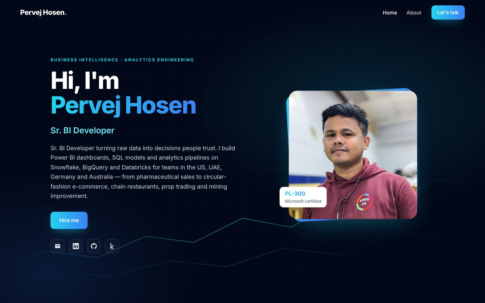

<h1 align="center">Pervej Hosen</h1>

<b>Sr. BI Developer · Independent Consultant</b> 
Power BI · SQL · Snowflake · BigQuery · Databricks · Python · Microsoft PL-300 certified

  

  🔗 <a href="https://pervejhosen.github.io"><b>pervejhosen.github.io</b></a> &nbsp;·&nbsp;
  <a href="https://www.linkedin.com/in/pervejhosen/">LinkedIn</a> &nbsp;·&nbsp;
  <a href="https://www.kaggle.com/pervejhosen">Kaggle</a> &nbsp;·&nbsp;
  <a href="mailto:pervejhosen2@gmail.com">Email</a>

---

I turn raw data into decisions people trust — Power BI dashboards, SQL models and analytics pipelines for teams in the **US, UAE, Germany and Australia**, across pharmaceutical sales, circular-fashion e-commerce, chain restaurants, prop trading and mining improvement.

This repository is the source of my portfolio site. Have a look at the [live site](https://pervejhosen.github.io), or [get in touch](mailto:pervejhosen2@gmail.com) if you have a dashboard to build or a reporting process to fix.

Built with plain HTML, CSS and JavaScript · hosted on GitHub Pages
